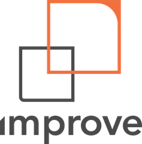
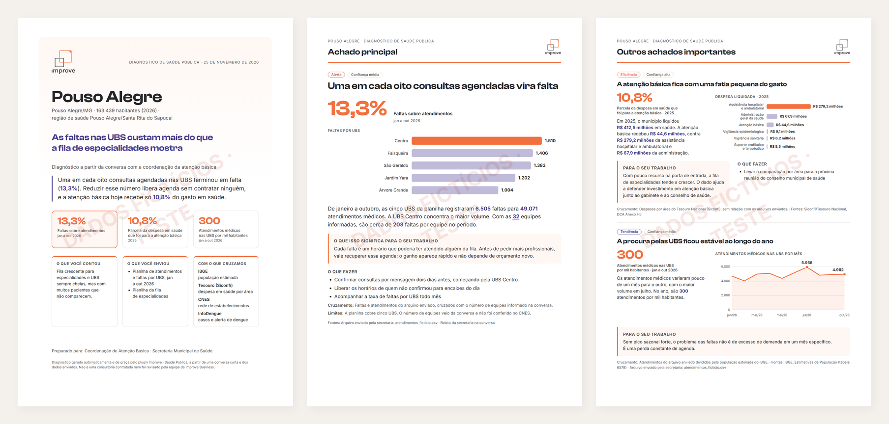
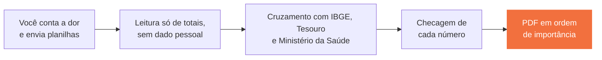

<p align="center">
  <picture>
    <source media="(prefers-color-scheme: dark)" srcset="docs/logo-improve-branco.png">
    
  </picture>
</p>

<h1 align="center">Diagnóstico de Saúde Pública</h1>

<p align="center">
  Você conta o problema da saúde do seu município e envia as planilhas que tiver.<br>
  O assistente cruza tudo com dados públicos e devolve um PDF curto, com o que mais importa na frente.
</p>

<p align="center">
  <a href="https://github.com/guilhermefaj/improve-saude/releases/latest"></a>
  
  
  <a href="LICENSE"></a>
</p>

<p align="center">
  <a href="#instalar-e-usar">Instalar e usar</a> ·
  <a href="#por-onde-começar">Por onde começar</a> ·
  <a href="#privacidade">Privacidade</a> ·
  <a href="docs/exemplo-diagnostico.pdf">PDF de exemplo</a>
</p>

<p align="center">
  <a href="docs/exemplo-diagnostico.pdf"></a><br>
  <sub>Exemplo gerado pelo plugin com planilhas fictícias e dados públicos reais. <a href="docs/exemplo-diagnostico.pdf">Veja o PDF completo</a>.</sub>
</p>

## Como funciona



- **Cada número tem origem.** Os valores saem de scripts que consultam as fontes ou leem seus arquivos, e o texto só cita esses valores. A última página do PDF diz de onde veio cada um.
- **Número inventado não passa.** Uma checagem automática recusa o documento se aparecer um valor que não saiu dos dados.
- **O mais importante ganha espaço.** O achado principal ocupa uma página inteira, com gráfico e ações. Os dois seguintes ganham meia página cada, e os demais entram numa lista.
- **Privacidade por padrão.** O documento usa só totais por município, unidade ou mês. CPF, nome e telefone são detectados e nunca aparecem.
- **Roda na sua máquina, de graça.** Os scripts são Python puro, sem pacotes para instalar, e o PDF é montado pelo seu próprio navegador. O diagnóstico é automático e gratuito, e o documento avisa que não é uma consultoria contratada.

## Instalar e usar

| Onde | Busca dados públicos | Entrega |
|---|---|---|
| **Claude Code** e **Cowork** (recomendado) | sim | PDF pronto |
| **Codex** (CLI, app ou extensão de IDE) | sim, depois de liberar a internet | PDF pronto |
| **Claude.ai** e **ChatGPT** | em geral não: usa seus arquivos e o que você contar | HTML, que você salva como PDF |

<details>
<summary><b>Claude Code</b></summary>

**Instalar**

```
/plugin marketplace add guilhermefaj/improve-saude
/plugin install improve-saude@improve-gestao-publica
```

**Usar.** Abra o Claude Code numa pasta de trabalho e conte o problema, ou digite `/improve-saude:diagnostico-saude`. Para enviar uma planilha, informe o caminho do arquivo ou arraste o arquivo para a janela. O Claude Code pede aprovação para rodar os scripts da skill. Aprove.

**Resultado.** `diagnostico-<municipio>.pdf` e `.html` na pasta de trabalho.

</details>

<details>
<summary><b>Cowork</b> (aplicativo de desktop)</summary>

**Instalar.** Nas configurações de plugins, adicione o marketplace `guilhermefaj/improve-saude` e instale **improve-saude**.

**Usar.** Escolha a pasta onde quer guardar os relatórios, conte o problema e anexe as planilhas.

**Resultado.** O PDF e o HTML ficam na pasta escolhida.

</details>

<details>
<summary><b>Codex</b></summary>

**Instalar.** No terminal:

```
codex plugin marketplace add guilhermefaj/improve-saude
codex plugin add improve-saude@improve-gestao-publica
```

Ou, dentro do Codex, digite `/plugins` e instale **Improve · Saúde Pública**.

**Usar.** Abra uma conversa nova e use uma das sugestões do plugin ou conte o problema. O Codex desliga a internet dos comandos por padrão. Quando a skill for buscar os dados públicos, aprove o acesso à rede. Para liberar de vez, acrescente ao `~/.codex/config.toml`:

```toml
[sandbox_workspace_write]
network_access = true
```

**Resultado.** `diagnostico-<municipio>.pdf` e `.html` na pasta do projeto.

</details>

<details>
<summary><b>Claude.ai</b> (navegador)</summary>

**Instalar**

1. Baixe [diagnostico-saude.zip](https://github.com/guilhermefaj/improve-saude/releases/latest/download/diagnostico-saude.zip).
2. Em **Configurações > Capacidades**, ative a execução de código e envie o `.zip` em **Skills**.

**Usar.** Numa conversa nova, conte o problema e anexe as planilhas.

**Resultado.** Um HTML para baixar. Abra no navegador e use **Imprimir > Salvar como PDF**. Aqui o ambiente costuma bloquear os sites do governo, então o documento usa só os seus arquivos e o que você contou, e avisa isso.

</details>

<details>
<summary><b>ChatGPT</b> (planos Business, Enterprise, Edu e Healthcare)</summary>

**Instalar.** O administrador do workspace precisa liberar o envio de skills.

1. Baixe [diagnostico-saude.zip](https://github.com/guilhermefaj/improve-saude/releases/latest/download/diagnostico-saude.zip), o mesmo do Claude.ai.
2. Abra **Skills**, escolha **Create > Upload from your computer** e envie o `.zip`.

**Usar e resultado.** Iguais aos do Claude.ai: você conta o problema, anexa as planilhas e recebe um HTML para salvar como PDF, feito só com os seus arquivos.

</details>

## Por onde começar

Não sabe o que pedir? Chame a skill sem dizer nada ou pergunte "como funciona?". Ela se apresenta e sugere jeitos de começar. Se você disser só o nome do município, ela traz um retrato com dados públicos para você escolher o foco.

| Situação | Comece com | O documento traz |
|---|---|---|
| Fila crescendo | "A fila de especialidades em Pouso Alegre (MG) não para de crescer. Segue a planilha de atendimentos." | Onde a agenda se perde, por unidade, e o que fazer primeiro |
| Prestar contas | "Preciso mostrar ao prefeito para onde vai o dinheiro da saúde." | O gasto por área, do Tesouro (Siconfi), e o que ele indica |
| Recurso federal | "Estamos perdendo dinheiro da atenção primária?" | Descontos no repasse da APS, classificação das equipes e cobertura |
| Vigilância | "Como está a dengue aqui em comparação com o começo do ano?" | Casos e nível de alerta do InfoDengue ao longo das semanas |
| Só um retrato | "Serra da Saudade, MG." | Um retrato curto com dados públicos, para você escolher o foco |

O assistente pergunta só o que faltar: o município, o seu cargo e para quem é o documento.

## Privacidade

- Só entram dados agregados por município, unidade ou mês. Nenhum dado de paciente ou de servidor entra no documento.
- Colunas com CPF, CNS, nome, nascimento, endereço, telefone ou e-mail são detectadas. Os valores delas nunca são exibidos nem usados para agrupar.
- Grupos com menos de 5 pessoas ou casos viram "Outros", mesmo em arquivos sem CPF ou nome.
- No Claude Code, no Cowork e no Codex, os arquivos ficam na sua máquina. No Claude.ai e no ChatGPT, ficam na sua conversa. As consultas às fontes públicas enviam só o código do município.

Detalhes em [lgpd.md](improve-saude/skills/diagnostico-saude/references/lgpd.md).

## Requisitos e problemas

- **Python 3.9 ou mais novo.** Usa só a biblioteca padrão, então não há nada para instalar.
- **Chrome, Edge ou Chromium** para montar o PDF na sua máquina. Sem navegador, o HTML sai pronto e você salva como PDF pela impressão.

Se algo não funcionar, rode o autoteste. Ele gera o diagnóstico de exemplo com dados fictícios e diz em qual etapa está o problema:

```
python improve-saude/skills/diagnostico-saude/scripts/autoteste.py
```

Mande o resultado para [contato@improve.business](mailto:contato@improve.business).

<details>
<summary><b>Por dentro do plugin</b></summary>

```
.claude-plugin/marketplace.json        catálogo do Claude (marketplace "improve-gestao-publica")
.agents/plugins/marketplace.json       o mesmo catálogo para o Codex
docs/                                  logo e diagnóstico de exemplo deste README
improve-saude/
  .claude-plugin/plugin.json, icon.png
  .codex-plugin/plugin.json            manifesto do Codex
  skills/diagnostico-saude/
    SKILL.md                           o fluxo que o assistente segue (padrão Agent Skills)
    agents/openai.yaml                 nome e descrição da skill no Codex
    references/                        contrato dos arquivos, fontes, mapa de dores, LGPD
    scripts/                           coleta, leitura de arquivos, checagem, HTML e PDF
    assets/                            logo da Improve e o exemplo fictício do autoteste
```

**Fontes públicas** (todas abertas, sem chave nem login):

| Fonte | O que traz |
|---|---|
| [IBGE](https://www.ibge.gov.br) | População, Censo 2022 (saneamento, idade, alfabetização) e IBGE Cidades (mortalidade infantil, internações por diarreia, IDHM) |
| [Tesouro Nacional · Siconfi](https://siconfi.tesouro.gov.br) | % aplicado em saúde, despesa por área, pessoal sobre a receita corrente líquida e emendas |
| [SIOPS](https://siops.datasus.gov.br) | Gasto por habitante e peso de pessoal, terceiros e medicamentos na despesa em saúde |
| [Fundo Nacional de Saúde](https://portalfns.saude.gov.br) | Repasses federais por bloco e descontos |
| [Relatório Público da APS](https://relatorioaps.saude.gov.br) | Cobertura da atenção primária, saúde bucal e ACS, repasse mensal e classificação das equipes |
| [CNES](https://cnes.datasus.gov.br) | Rede de estabelecimentos |
| [InfoDengue](https://info.dengue.mat.br) | Casos e alerta de dengue, chikungunya e zika |

**Tipografia:** os títulos usam Clash Display, da Fontshare, e o texto usa Inter (licença OFL), do Google Fonts. As duas são carregadas quando o documento é aberto. Sem internet, o documento usa Arial.

</details>

---

<p align="center">
  Feito pela <a href="https://improve.business">Improve Business</a> · <a href="mailto:contato@improve.business">contato@improve.business</a><br>
  <sub>Código sob a <a href="LICENSE">licença MIT</a>. A marca e o logo da Improve Business não fazem parte da licença.</sub>
</p>
